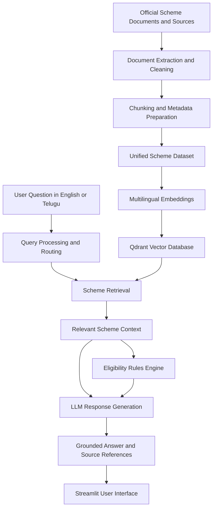

# MultiRAG P2 — Multilingual Government Scheme Discovery and Eligibility Assistant

An AI-powered, multilingual Retrieval-Augmented Generation (RAG) system that helps users discover government welfare schemes and understand their eligibility across **Central Government, Andhra Pradesh, and Telangana**.

The project combines multilingual semantic retrieval, structured scheme metadata, rule-based eligibility evaluation, and large language models (LLMs) to provide accessible, context-aware information in **English and Telugu**.

---

## Table of Contents

- [1. Project Overview](#1-project-overview)
- [2. Problem Statement](#2-problem-statement)
- [3. Objectives](#3-objectives)
- [4. Key Features](#4-key-features)
- [5. Target Users](#5-target-users)
- [6. System Architecture](#6-system-architecture)
- [7. How the System Works](#7-how-the-system-works)
- [8. Eligibility Evaluation](#8-eligibility-evaluation)
- [9. Technology Stack](#9-technology-stack)
- [10. Dataset Overview](#10-dataset-overview)
- [11. Project Structure](#11-project-structure)
- [12. Installation and Setup](#12-installation-and-setup)
- [13. Running the Application](#13-running-the-application)
- [14. Example Queries](#14-example-queries)
- [15. Data Preparation and Validation](#15-data-preparation-and-validation)
- [16. Security and Data Management](#16-security-and-data-management)
- [17. Limitations and Future Enhancements](#17-limitations-and-future-enhancements)
- [18. Conclusion](#18-conclusion)

---

## 1. Project Overview

Government welfare schemes provide financial assistance, healthcare support, education benefits, agricultural assistance, housing support, pensions, and other services. However, citizens may find it difficult to identify relevant schemes and understand their eligibility requirements because information is distributed across multiple official documents and portals.

**MultiRAG P2** addresses this challenge through a centralized, multilingual scheme discovery and eligibility assistance platform.

The system processes scheme documents and structured metadata, retrieves information relevant to a user's question, evaluates eligibility using predefined rules where supported, and generates a grounded response using an LLM.

The application is designed to help users understand:

- Which government schemes may be relevant to their needs.
- What eligibility criteria apply to a particular scheme.
- Which benefits and exclusions are documented.
- What additional information may be needed to assess eligibility.
- Where to find the corresponding official scheme information.

**Important:** The system provides informational assistance. Its results do not constitute an official government eligibility decision or guarantee approval of an application.

## 2. Problem Statement

Government scheme information is often distributed across guidelines, government orders, departmental websites, PDFs, and state-specific portals.

Users may face the following challenges:

1. **Information fragmentation:** Relevant information is spread across Central and state government sources.
2. **Complex eligibility criteria:** Scheme requirements may involve age, income, occupation, residence, social category, land ownership, or other conditions.
3. **Language barriers:** Citizens may prefer Telugu over English when accessing public information.
4. **Difficulty finding relevant schemes:** Users may not know the official name of a scheme or which department administers it.
5. **Unreliable answers:** A general-purpose chatbot may produce unsupported or outdated eligibility claims.

MultiRAG P2 aims to address these challenges through multilingual retrieval, structured scheme information, rule-based evaluation, and source-grounded response generation.

## 3. Objectives

- Build a unified scheme discovery system for Central, Andhra Pradesh, and Telangana government schemes.
- Support questions in English and Telugu.
- Use multilingual semantic embeddings to retrieve relevant information even when the query wording differs from the source document.
- Evaluate supported eligibility conditions using a deterministic rules engine.
- Generate responses grounded in retrieved scheme information rather than relying exclusively on an LLM's internal knowledge.
- Maintain structured metadata and official-source references to improve traceability.
- Provide an accessible Streamlit-based interface for interacting with the system.

## 4. Key Features

### Multilingual scheme discovery

Users can ask natural-language questions about welfare schemes in English or Telugu. Multilingual retrieval helps match questions with relevant documents and scheme records.

### Multi-jurisdiction coverage

The dataset includes schemes from:

- Central Government
- Government of Andhra Pradesh
- Government of Telangana

### Retrieval-Augmented Generation

The system retrieves relevant scheme information and supplies it as context to the LLM, helping keep generated answers connected to the available data.

### Rule-based eligibility evaluation

Structured eligibility conditions are evaluated separately from response generation. This reduces reliance on the LLM for decisions that should follow explicit rules.

### Structured scheme metadata

Scheme records can include eligibility criteria, benefits, source references, jurisdiction, and other available attributes.

### Official-source traceability

Official URLs and source metadata help users verify information against the relevant government source where available.

### Interactive user interface

The Streamlit frontend provides the interface for submitting questions and viewing scheme discovery and eligibility assistance results.

---

## 5. Target Users

| User group | How the system helps |
|---|---|
| Citizens and beneficiaries | Discover potentially relevant government schemes. |
| Students | Explore scholarships and education assistance. |
| Farmers | Find agricultural support and related schemes. |
| Low-income households | Explore documented housing, pension, healthcare, and financial assistance schemes. |
| Researchers and students | Examine scheme information and eligibility conditions across jurisdictions. |
| Public-service facilitators | Help people navigate available scheme information. |

Eligibility depends on each scheme's actual conditions. The system should not assume that a user qualifies based only on a general description of their circumstances.

## 6. System Architecture

The application follows a Retrieval-Augmented Generation architecture with a separate eligibility evaluation component.

### High-level architecture



### Architecture components

**1. Data ingestion layer**

Collects available scheme documents and structured information, including government PDFs, extracted text, and state-specific scheme records.

**2. Processing layer**

Cleans extracted content, prepares document chunks, and associates information with relevant metadata.

**3. Retrieval layer**

Uses multilingual embeddings and a vector database to find semantically relevant scheme information. Query routing and search modules coordinate retrieval.

**4. Eligibility layer**

Evaluates supported eligibility criteria using structured rules and user-provided information.

**5. Response generation layer**

Uses an LLM through OpenRouter to generate a natural-language answer based on the retrieved context and eligibility results.

**6. Presentation layer**

Provides the user-facing Streamlit interface through `app.py`.

## 7. How the System Works

The system has two primary workflows.

### A. Offline data preparation

1. Collect available scheme documents and structured records.
2. Extract text from source documents.
3. Clean and normalize extracted content.
4. Split long documents into smaller chunks suitable for retrieval.
5. Attach relevant metadata, including scheme and jurisdiction information.
6. Build a unified RAG dataset.
7. Generate multilingual embeddings using BGE-M3.
8. Build or update the Qdrant vector index.

### B. Online question answering

1. The user submits a question in English or Telugu.
2. The query-processing layer identifies the question's intent and routes it to the relevant search workflow.
3. The retrieval component searches for relevant scheme records and document context.
4. The eligibility engine evaluates applicable structured rules when sufficient user information is available.
5. The LLM receives the relevant context and produces a readable answer.
6. The application presents the response and available official-source references.

The exact answer depends on the retrieved evidence, the completeness of the dataset, the supported eligibility rules, and the information supplied by the user.

## 8. Eligibility Evaluation

Eligibility checking is a core design component of MultiRAG P2.

Rather than delegating the final eligibility assessment entirely to an LLM, the system uses structured criteria and a dedicated rule-evaluation workflow.

### Typical eligibility attributes

Depending on the scheme, the available criteria may include:

- Age
- Annual household income
- State or district of residence
- Occupation
- Farmer or landholder status
- Educational qualification
- Social category, where applicable
- Household circumstances
- Scheme-specific exclusions

Not every scheme uses all these attributes.

### Eligibility workflow

1. Identify the scheme or schemes relevant to the user's question.
2. Collect the user attributes required by the applicable rules.
3. Evaluate the supported conditions.
4. Identify satisfied, unsatisfied, or insufficiently specified conditions where the implementation supports those distinctions.
5. Present the result with an explanation and available source information.

### Important design principle

**Retrieval finds relevant information; the rules engine evaluates structured eligibility conditions; the LLM explains the result.**

An unknown or missing attribute should not automatically be interpreted as satisfying an eligibility requirement. Where information or rules are incomplete, the result should communicate the uncertainty rather than claim official approval.

---

## 9. Technology Stack

| Technology | Purpose |
|---|---|
| Python | Main application and processing language |
| Streamlit | Interactive user interface |
| BGE-M3 | Multilingual text embeddings |
| Qdrant | Vector storage and similarity-based retrieval |
| OpenRouter | Access to the configured language model |
| Large Language Model | Context-grounded natural-language response generation |
| JSON | Structured scheme metadata, eligibility rules, and datasets |
| PDF and text-processing utilities | Source document extraction and preprocessing |
| Git and GitHub | Version control and source-code hosting |

The repository's `requirements.txt` defines the Python dependencies. The local BGE-M3 model and generated vector database are managed separately from the source-code repository.

## 10. Dataset Overview

The current unified dataset validation recorded the following statistics:

| Dataset attribute | Validated count |
|---|---:|
| Total records | 1,351 |
| Central Government records | 1,109 |
| Andhra Pradesh records | 188 |
| Telangana records | 54 |
| Unique schemes | 45 |
| Duplicate chunks found | 0 |
| Missing eligibility fields in the validated dataset | 0 |

These figures describe the validated dataset at the time of the recorded validation. They do not guarantee that every field is complete for every scheme or that every scheme's current eligibility rules have been independently confirmed.

### Dataset organization

**Raw sources**

- `data/raw/central/`
- `data/raw/andhra_pradesh/`
- `data/raw/telangana/`

**Processed documents**

- `data/processed/text/` — extracted text from source documents.
- `data/processed/chunks/` — chunked documents used for retrieval.
- `data/processed/unified/rag_documents.json` — unified RAG dataset.
- `data/processed/central_eligibility_all_candidates.json` — collected Central scheme eligibility candidates.

**Metadata**

- `data/metadata/` — structured scheme records, eligibility rules, source references, and jurisdiction-specific metadata.

Official scheme details can change. Before relying on an answer for an application, users should verify the latest eligibility conditions and application instructions with the responsible government department.

## 11. Project Structure

```text
MultiRAG_P2/
│
├── app.py
├── requirements.txt
├── .gitignore
├── .streamlit/
│   └── config.toml
│
├── backend/
│   ├── build_vector_index.py
│   ├── data_loader.py
│   ├── discovery_search.py
│   ├── eligibility_engine.py
│   ├── eligibility_rules.py
│   ├── eligibility_service.py
│   ├── llm_client.py
│   ├── profile_mapper.py
│   ├── query_router.py
│   ├── question_generator.py
│   ├── rule_evaluator.py
│   ├── scheme_search.py
│   └── unified_dataset_builder.py
│
├── data/
│   ├── config/
│   ├── metadata/
│   ├── raw/
│   │   ├── central/
│   │   ├── andhra_pradesh/
│   │   └── telangana/
│   ├── processed/
│   │   ├── chunks/
│   │   ├── text/
│   │   └── unified/
│   └── vector_db/
│
├── models/
│   └── bge-m3/
│
├── scripts/
│   ├── build_unified_rag_dataset.py
│   ├── download_bge_m3.py
│   ├── test_bge_m3.py
│   ├── validate_all_metadata.py
│   └── validate_central_metadata.py
│
├── document_processor.py
├── chunk_documents.py
├── ocr_processor.py
├── state_scraper.py
└── other document-processing and inspection scripts
```

This is a functional overview of the repository layout. Some generated folders, local assets, and files may differ depending on the environment.

### Important backend modules

| Module | Responsibility |
|---|---|
| `app.py` | Streamlit application entry point |
| `backend/query_router.py` | Routes incoming queries |
| `backend/discovery_search.py` | Scheme discovery and search |
| `backend/scheme_search.py` | Scheme search functionality |
| `backend/eligibility_engine.py` | Eligibility evaluation workflow |
| `backend/eligibility_rules.py` | Structured eligibility rules |
| `backend/eligibility_service.py` | Eligibility service orchestration |
| `backend/rule_evaluator.py` | Evaluates applicable rule conditions |
| `backend/profile_mapper.py` | Maps user profile information to supported fields |
| `backend/llm_client.py` | LLM interaction through OpenRouter |
| `backend/build_vector_index.py` | Vector-index construction |
| `backend/unified_dataset_builder.py` | Unified dataset construction |

## 12. Installation and Setup

### Prerequisites

- Windows, macOS, or Linux
- Python 3.11 or another Python version compatible with the installed dependencies
- Git
- Internet access for dependency installation and API access
- An OpenRouter API key for LLM requests
- Sufficient disk space and memory for the BGE-M3 embedding model

### Step 1: Clone the repository

```bash
git clone https://github.com/TejasManindra/MULTILINGUAL_RAG_P2.git
cd MULTILINGUAL_RAG_P2
```

### Step 2: Create a virtual environment

**Windows PowerShell**

```powershell
python -m venv .venv
.\.venv\Scripts\Activate.ps1
```

**macOS or Linux**

```bash
python3 -m venv .venv
source .venv/bin/activate
```

### Step 3: Install dependencies

```bash
python -m pip install --upgrade pip
pip install -r requirements.txt
```

If installation fails, verify that the Python version and package versions are compatible with the project.

### Step 4: Configure the API key

Create a `.env` file in the project root and configure the OpenRouter API key used by the application.

```dotenv
OPENROUTER_API_KEY=your_openrouter_api_key
OPENROUTER_MODEL=openrouter/free
```

Replace the placeholder with your own API key. The model value above is the default used by the current LLM client unless overridden.

Keep `.env` private. Never commit API keys to GitHub.

### Step 5: Prepare the embedding model

The project uses BGE-M3 for multilingual embeddings. The model is a large local asset and is not included in the Git repository.

If it is not already present, inspect the project's download script:

```powershell
python scripts/download_bge_m3.py
```

Verify that the model files are available under the expected `models/bge-m3/` directory. The exact model-loading requirements depend on the current implementation and installed packages.

### Step 6: Prepare the vector index

The application requires its vector index to be built or available before retrieval can work.

Inspect the existing index-building implementation and use the project's supported entry point. For example, if the script exposes a standard command-line entry point:

```powershell
python backend/build_vector_index.py
```

If the script does not support direct execution, use the invocation documented in its source code. Avoid rebuilding an existing index unnecessarily.

## 13. Running the Application

From the project root, with the virtual environment activated:

```powershell
streamlit run app.py
```

Streamlit normally displays a local URL, commonly:

```text
http://localhost:8501
```

Open the displayed URL in your browser.

If the application fails to start, check the following:

1. The virtual environment is activated.
2. Dependencies are installed.
3. The required environment variables are configured.
4. The embedding model exists at the expected path.
5. The vector database has been initialized.
6. The configured LLM model is available through the API provider.

**Note:** The commands above describe the intended setup workflow. The vector-index build command and all dependency requirements should be verified against the actual scripts before using them in a clean environment.

## 14. Example Queries

The following examples illustrate intended usage; they are not claims that every query has already been tested end to end.

### Scheme discovery

- "Which government schemes provide housing assistance?"
- "What schemes may support small farmers?"
- "What scholarships are available for eligible students?"

### State-specific discovery

- "Find relevant government schemes for residents of Andhra Pradesh."
- "Which Telangana schemes provide pension assistance?"
- "What Central Government schemes support healthcare?"

### Eligibility questions

- "What are the eligibility criteria for PM-KISAN?"
- "What information is needed to assess eligibility for a scholarship?"
- "Based on my age, income, and occupation, which schemes should I investigate?"

### Telugu queries

- "రైతులకు అందుబాటులో ఉన్న ప్రభుత్వ పథకాలు ఏమిటి?"
- "విద్యార్థులకు స్కాలర్‌షిప్ పథకాలు ఏవి?"
- "ఈ పథకానికి అర్హత ప్రమాణాలు ఏమిటి?"

The quality of the answer depends on the availability of the relevant scheme data, retrieval results, supported language handling, and implemented eligibility rules.

## 15. Data Preparation and Validation

The repository contains scripts for extracting, preparing, and validating scheme information.

| Script | Purpose |
|---|---|
| `document_processor.py` | Document-processing workflow |
| `chunk_documents.py` | Document chunk preparation |
| `ocr_processor.py` | OCR-related document processing |
| `state_scraper.py` | State scheme data collection |
| `scripts/build_unified_rag_dataset.py` | Unified RAG dataset construction |
| `scripts/validate_all_metadata.py` | Metadata validation |
| `scripts/validate_central_metadata.py` | Central scheme metadata validation |
| `scripts/test_bge_m3.py` | Embedding model checks |

A recommended data-maintenance workflow is:

1. Collect and verify source documents.
2. Extract and normalize document text.
3. Review scheme names, jurisdictions, eligibility criteria, and official URLs.
4. Build or update the unified dataset.
5. Run metadata and chunk validation.
6. Rebuild the vector index when the indexed content changes.
7. Test representative English and Telugu queries.

Validation of structure and completeness does not, by itself, prove that every extracted eligibility statement is factually correct or currently in force.

## 16. Security and Data Management

The following files and directories are intended to remain local or environment-specific:

- `.env` — API keys and private configuration.
- `.venv/` — local Python environment.
- `models/` — downloaded embedding-model files.
- `data/vector_db/` — generated vector-index data.

These assets can be recreated or configured locally as appropriate. Their absence from a fresh Git clone may mean that additional setup is required before the application can run.

Before publishing changes, verify that no API keys, credentials, private user data, or unintended generated files are staged.

## 17. Limitations and Future Enhancements

### Current limitations

- Scheme coverage is limited to the available Central, Andhra Pradesh, and Telangana data.
- Scheme information may become outdated when government rules or application procedures change.
- Retrieval quality depends on source quality, document extraction, chunking, and embedding performance.
- Eligibility results depend on the completeness and correctness of the encoded rules.
- An LLM may still produce unsupported details if retrieval context is insufficient; answers must be checked against official sources.
- A fresh installation may require a separate model download and vector-index setup.
- Production readiness, security, deployment scalability, and end-to-end accuracy require further testing.

### Future enhancements

- Expand coverage to additional Indian states and union territories.
- Add automated monitoring for changes to official scheme portals and government orders.
- Improve Telugu query normalization and cross-language retrieval evaluation.
- Add explainable eligibility reports showing which conditions were satisfied, failed, or remain unknown.
- Improve source-level citations and evidence tracing for individual claims.
- Add automated unit, integration, retrieval-quality, and eligibility-rule tests.
- Introduce a repeatable data-refresh and vector-index rebuilding pipeline.
- Deploy the application with appropriate authentication, monitoring, and operational safeguards.
- Evaluate response faithfulness and eligibility accuracy against a reviewed benchmark dataset.

## 18. Conclusion

MultiRAG P2 brings together multilingual retrieval, structured government scheme information, rule-based eligibility evaluation, and LLM-assisted explanation in a single application.

Its primary objective is to make government scheme information easier to discover and understand while keeping eligibility assessment grounded in explicit criteria and available evidence.

By combining semantic search with structured rules and official-source references, the project establishes a foundation for a more accessible and transparent government scheme discovery assistant.

---

## Repository

GitHub: https://github.com/TejasManindra/MULTILINGUAL_RAG_P2

## Disclaimer

This project is intended for educational, research, and informational purposes. It is not an official government service. Scheme information and eligibility assessments should be verified with the relevant government department or official portal before making decisions or submitting applications.
